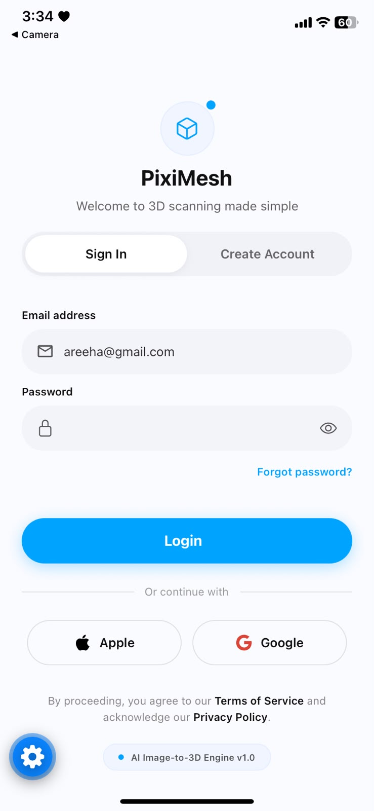
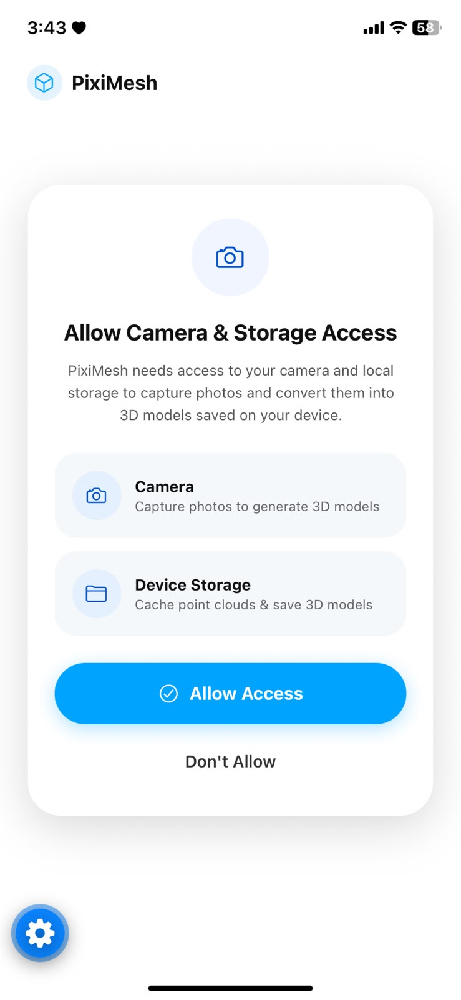
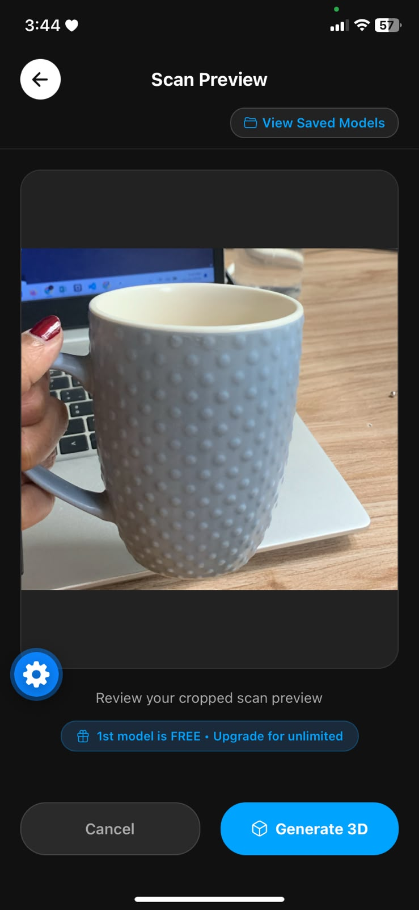
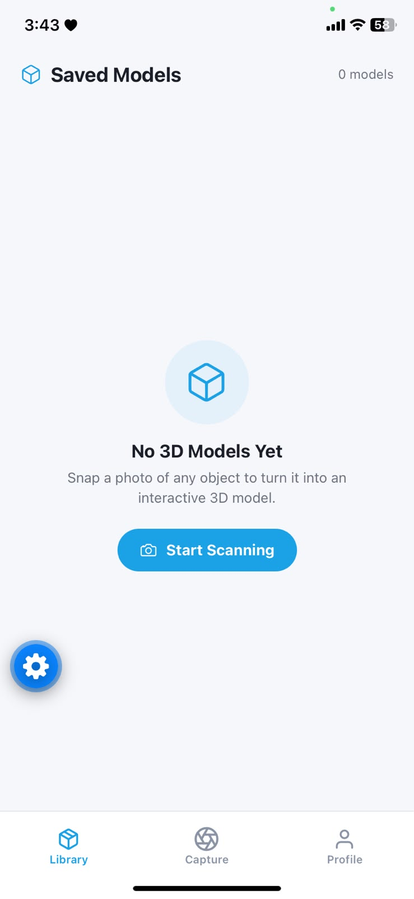
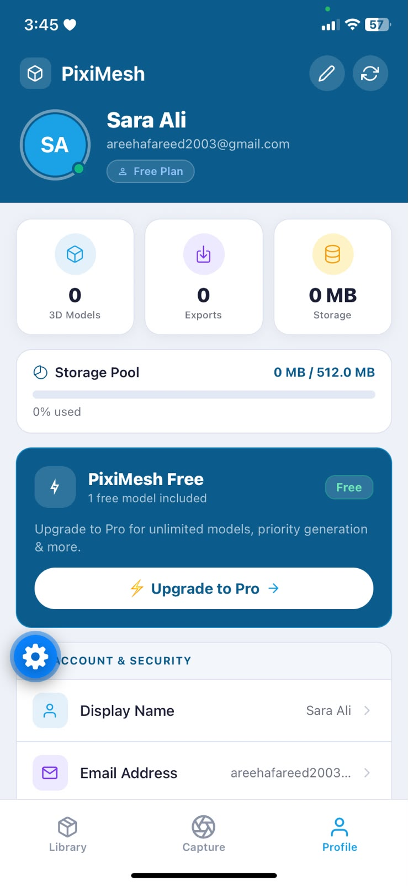

<div align="center">


# PixiMesh — Spatial3DApp

**Turn a single photo into an interactive 3D model — right on your phone.**

📷 Snap → ✂️ Crop → 🤖 AI → 🧊 3D Viewer

[](https://docs.expo.dev)
[](https://reactnative.dev)
[](https://github.com/Areehaafareed/scanner_backend)
[](https://cloud.mongodb.com)
[](https://piximesh-backend-api.netlify.app/api/health)
[](https://stripe.com)
[](LICENSE)

</div>

---

## 📖 About

**PixiMesh** (`Spatial3DApp`) is a React Native / Expo mobile application that turns ordinary camera photos into interactive 3D models (`.glb`) that you can inspect, rotate, zoom, and save to your library.

> **No LiDAR or depth sensors required.** PixiMesh uses standard camera capture — you frame an object, snap a single photo, and the AI image-to-3D pipeline ([Meshy AI](https://meshy.ai)) reconstructs a textured 3D mesh (`.glb`) with live progress updates.

---

## 📱 Screenshots

<div align="center">

| Sign In / Sign Up | Permissions Onboarding | Scan Preview |
| :---: | :---: | :---: |
|  |  |  |

| Saved Models Library | Live Profile & Stats |
| :---: | :---: |
|  |  |

</div>

---

## ✨ Features

- 📸 **Simple Photo Capture** — live camera view with framing guide, rule-of-thirds grid toggle, and flashlight control (no LiDAR needed)
- ✂️ **Automatic Framing Crop** — crops precisely to the on-screen scanning frame before upload
- 🤖 **AI Image-to-3D Generation** — converts the photo into a `.glb` 3D mesh via Meshy AI with real-time progress polling and local task caching
- 🧊 **Interactive 3D Viewer** — rotates and zooms `.glb` models smoothly in-app using `<model-viewer>` inside a WebView
- 🗂 **Personal 3D Library** — stores `.glb` models locally on-device while syncing model names and sizes to MongoDB Atlas
- 👤 **Full Account & Profile System** — JWT-authenticated signup/login, live model & storage usage stats, edit display name/email, change password, and persistent preferences
- 💳 **PixiMesh Pro Subscriptions** — Stripe monthly & annual checkout with Apple Pay / Google Pay support (first model is free, Pro unlocks unlimited generations)
- 📱 **Expo Go + Native EAS Support** — guarded Stripe bridge lets the full scanning/3D/profile experience run in Expo Go on iOS/Android, while EAS builds enable full native Stripe payments

---

## 🏗 Architecture

```
┌──────────────────────┐        ┌──────────────────────────┐        ┌────────────┐
│    PixiMesh App      │        │  Backend (Express 5)     │        │  MongoDB   │
│  React Native / Expo │ ─────▶ │  Netlify Functions       │ ─────▶ │   Atlas    │
│                      │  JWT   │  auth · profile ·        │        └────────────┘
│  Meshy Image-to-3D   │        │  models · payments       │        ┌────────────┐
│  + Local GLB Storage │        └────────────┬─────────────┘        │   Stripe   │
└──────────┬───────────┘                     │ webhooks             │            │
           │ HTTPS (Meshy REST API)          └─────────────────────▶└────────────┘
           ▼
     ┌──────────┐
     │ Meshy AI │  photo → 3D mesh (.glb), polled until ready
     └──────────┘
```

| Component | Stack / Hosting |
| --- | --- |
| 📱 Mobile App | **This repo** — Expo SDK 58, React Native 0.88, React Navigation 7 |
| 🖥 Backend API | [`Areehaafareed/scanner_backend`](https://github.com/Areehaafareed/scanner_backend) — Express 5 + Mongoose, hosted on **Netlify Functions** |
| 🧠 3D Generation | [Meshy AI — Image to 3D API](https://docs.meshy.ai/en/api) |
| 💳 Payments | Stripe Subscriptions + `@stripe/stripe-react-native` |
| 🗄 Database | MongoDB Atlas |
| 🧊 3D Renderer | [`<model-viewer>`](https://modelviewer.dev) inside `react-native-webview` |

---

## 🖥 App Flow & Screens

```
AuthScreen ──▶ OnboardingScreen (Camera + Storage permissions)
                    │
                    ▼
                MainTabs
        ┌────────────┼──────────────┐
        ▼            ▼              ▼
     Library      Capture        Profile
  (saved models)  (camera)   (stats, edit, password, plan)
        │            │
        │            ▼
        │      ScanPreviewScreen ──▶ Meshy AI ──▶ ModelViewerScreen
        │            │
        │            ▼
        └──── CheckoutScreen (Stripe Pro upgrade)
```

| Screen | Purpose |
| --- | --- |
| `AuthScreen` | Email + password Sign In / Create Account with password strength meter & JWT sessions |
| `OnboardingScreen` | Glassmorphism permission primer for Camera & Media Library access |
| `ScannnerScreen` | Live camera scanner with corner framing guide, grid overlay, and torch toggle |
| `ScanPreviewScreen` | Cropped shot preview, free-trial check, AI 3D generation progress, and model naming |
| `ModelListScreen` | Saved `.glb` models library with file size, date, and backend-synced names |
| `ModelViewerScreen` | Interactive auto-rotating 3D viewer for `.glb` meshes |
| `ProfileScreen` | Live backend stats, storage usage bar, Pro badge, edit name/email, change password, preferences, and logout |
| `CheckoutScreen` | Stripe monthly/annual subscription checkout with card input and Apple Pay / Google Pay |

---

## 🚀 Getting Started

### Prerequisites

- Node.js `>= 18`
- [Expo Go](https://expo.dev/go) on iOS/Android (for quick testing) or EAS CLI (`npx eas-cli@latest`) for native builds
- A [Meshy AI](https://dashboard.meshy.ai) API key
- Running instance of the backend ([`scanner_backend`](https://github.com/Areehaafareed/scanner_backend)) — local or hosted on Netlify

### 1. Clone & Install

```bash
git clone https://github.com/Areehaafareed/Spatial3DApp.git
cd Spatial3DApp
npm install
cp .env.example .env
```

### 2. Configure `.env`

```env
# Meshy AI API key
EXPO_PUBLIC_MESHY_KEY=your_meshy_api_key

# Backend base URL (must include /api)
EXPO_PUBLIC_API_URL=https://piximesh-backend-api.netlify.app/api
# Or for local backend dev: http://<your-lan-ip>:5000/api
```

> `EXPO_PUBLIC_*` values are bundled at build/start time — always restart Expo with `-c` after editing `.env`.

### 3. Run on Your Phone

```bash
# Start Metro dev server and scan the QR code with Expo Go (iOS Camera / Android Expo Go)
npx expo start -c

# Or use tunnel mode if your phone and PC are on different networks
npx expo start --tunnel -c
```

> **Note on Stripe:** Because `@stripe/stripe-react-native` requires custom native code, [`StripeBridge.js`](src/services/StripeBridge.js) safely skips loading native Stripe inside Expo Go so all scanning, 3D generation, library, and profile features work seamlessly. Use an EAS build for full Stripe card / Apple Pay / Google Pay testing.

### 4. Build Native Apps with EAS

```bash
npx eas-cli@latest login
npx eas-cli@latest build --platform android --profile preview      # Standalone Android APK
npx eas-cli@latest build --platform android --profile development  # Dev client with Stripe
npx eas-cli@latest build --platform ios --profile development      # iOS dev client (requires Apple Developer account)
```

---

## 📡 Backend API Endpoints

The app communicates with `EXPO_PUBLIC_API_URL` ([`scanner_backend`](https://github.com/Areehaafareed/scanner_backend)):

| Purpose | Endpoint |
| --- | --- |
| Health check | `GET /health` |
| Create account | `POST /auth/signup` → `{ token, user }` |
| Sign in | `POST /auth/login` → `{ token, user }` |
| Current session | `GET /auth/me` → `{ user }` |
| Change password | `PATCH /auth/password` → `{ ok: true }` |
| Profile & stats | `GET /profile` → `{ user, stats }` |
| Update name / email | `PATCH /profile` → `{ user }` |
| Save model metadata | `POST /models` `{ taskId, name, sizeKb }` |
| List user models | `GET /models` |
| Start Pro subscription | `POST /payments/create-subscription` `{ plan }` |
| Subscription status | `GET /payments/status` → `{ isPro, plan }` |

All protected endpoints send `Authorization: Bearer <jwt>` stored locally via `AsyncStorage`.

---

## 📂 Project Structure

```
Spatial3DApp/
├── App.js                        # Root stack navigator + StripeBridge provider
├── app.json                      # Expo config (plugins, icons, EAS project ID)
├── eas.json                      # EAS Build profiles (development, preview, production)
├── docs/
│   └── screenshots/              # App screenshots used in README
├── assets/                       # App icons & splash screen
└── src/
    ├── navigation/
    │   └── MainTabs.js           # Bottom tabs: Library · Capture · Profile
    ├── screens/
    │   ├── AuthScreen.js         # Sign in / Create account (JWT)
    │   ├── OnboardingScreen.js   # Camera & storage permission modal
    │   ├── ScannnerScreen.js     # Camera capture + framing crop
    │   ├── ScanPreviewScreen.js  # Review + Meshy 3D generation + naming
    │   ├── ModelViewerScreen.js  # <model-viewer> WebView for .glb files
    │   ├── ModelListScreen.js    # Saved 3D models library
    │   ├── ProfileScreen.js      # Live stats, storage bar, edit profile & password
    │   └── CheckoutScreen.js     # Stripe Pro subscription checkout
    └── services/
        ├── Api.js                # Central fetch client (JWT + EXPO_PUBLIC_API_URL)
        ├── AuthService.js        # signup / login / changePassword / session
        ├── ProfileService.js     # profile + stats + subscription status
        ├── ModelService.js       # Meshy pipeline + local cache + backend sync
        └── StripeBridge.js       # Safe native Stripe wrapper with Expo Go fallback
```

---

## ⚠️ Security Notes

- **Never commit `.env`.** Keep API keys (`EXPO_PUBLIC_MESHY_KEY`, `MONGO_URI`, `JWT_SECRET`, `STRIPE_SECRET_KEY`) out of git history.
- The Stripe **publishable** key in `App.js` is safe for client apps; secret keys and webhook secrets live exclusively in backend environment variables.
- Passwords are hashed server-side with `bcryptjs`.

---

## 📄 License

Distributed under the [MIT License](LICENSE).

---

<div align="center">
Made with 📷 + 🧊 by <a href="https://github.com/Areehaafareed">Areeha Fareed</a>
</div>
